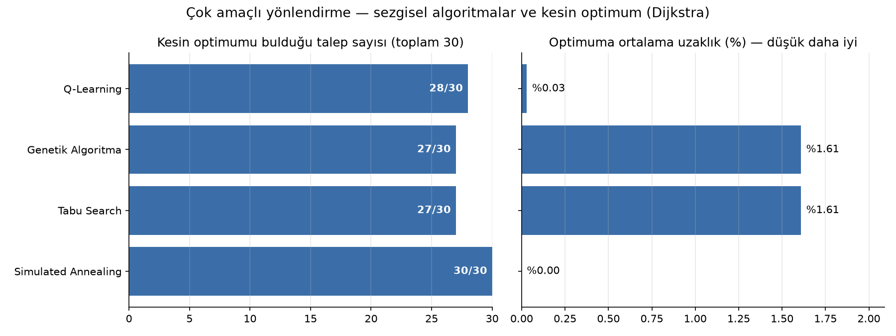

# 🌐 Çok Amaçlı Ağ Optimizasyonu — Yönlendirme (Routing)

> **Bilgisayar Ağları Dönem Projesi (BSM307/317) — Güz 2025**  
> Python • NetworkX • Genetik Algoritma • Tabu Search • Simulated Annealing • Q-Learning  
> 250 düğümlü, 12 452 bağlantılı bir ağda gecikme, güvenilirlik ve kaynak maliyetini birlikte optimize eden yönlendirme

[](https://www.python.org/)
[](https://networkx.org/)
[](https://pandas.pydata.org/)
[](https://matplotlib.org/)

---

## 👥 Ekip

Bu proje ders kapsamında **ekip çalışmasıyla** geliştirilmiştir.

| İsim | Bölüm | GitHub | LinkedIn | İletişim / E-Posta |
|------|-------|--------|----------|-------------------|
| **Hüseyin Konak** | Bilgisayar Mühendisliği | [@huseyin-konak](https://github.com/huseyin-konak) | [linkedin.com/in/huseyin-konak](https://www.linkedin.com/in/huseyin-konak/) | [huseyinkonak.dev@gmail.com](mailto:huseyinkonak.dev@gmail.com) |

---

## 📑 İçindekiler

1. [Problem](#-problem)
2. [Kullanılan Algoritmalar](#-kullanılan-algoritmalar)
3. [Sonuçlar](#-sonuçlar)
4. [Proje Dizin Yapısı](#-proje-dizin-yapısı)
5. [Kurulum ve Çalıştırma](#-kurulum-ve-çalıştırma)
6. [Sınırlamalar](#-sınırlamalar)

---

## 🎯 Problem

Bir ağda kaynaktan hedefe giden yolun kalitesi tek bir ölçüyle belirlenmez. Her yol için üç maliyet hesaplanır:

| Amaç | Hesaplama |
|---|---|
| **Gecikme** | Bağlantı gecikmeleri + ara düğümlerin işlem süreleri (ms) |
| **Güvenilirlik** | Bağlantı ve düğüm güvenilirlikleri `-log(güvenilirlik)` ile toplanabilir maliyete çevrilir |
| **Kaynak maliyeti** | Her bağlantı için `1000 / kapasite (Mbps)` |

Üç maliyet **ağırlıklı toplam (weighted sum)** yöntemiyle tek bir uygunluk (fitness) değerine indirgenir (varsayılan ağırlıklar 0,33 / 0,33 / 0,34; düşük değer daha iyi). Talepte istenen bant genişliğini karşılamayan bir bağlantı içeren yol geçersizdir.

Veri seti: 250 düğüm (işlem süresi, güvenilirlik), 12 452 bağlantı (kapasite, gecikme, güvenilirlik) ve 30 trafik talebi (kaynak, hedef, istenen bant genişliği).

---

## 🤖 Kullanılan Algoritmalar

| Algoritma | Yaklaşım |
|---|---|
| **Dijkstra (referans)** | Ağırlıklı toplam maliyet bağlantılar üzerinde toplanabilir olduğundan, bant genişliği filtrelenmiş grafta her bağlantıya *bağlantı + girilen düğüm* maliyeti verilerek **kesin optimum** bulunur. Sezgisel algoritmaların başarısı bu referansla ölçülür. |
| **Genetik Algoritma** | Rastgele yürüyüşle üretilen yol popülasyonu; turnuva seçimi, elitizm, tek noktalı çaprazlama ve yolu kısaltan / değiştiren mutasyonlar. Kopan bağlantılar en kısa yolla onarılır, oluşan döngüler kesilir. |
| **Tabu Search** | En az atlamalı geçerli yoldan başlar; bir ara düğümü ortak komşuyla değiştirerek komşu çözümler üretir. Son çözümler tabu listesinde tutulur (aspiration kriteriyle). |
| **Simulated Annealing** | Düğüm silme, ekleme, değiştirme ve yer değiştirme hamleleri; daha kötü çözümler `exp(-Δ/T)` olasılıkla kabul edilir, sıcaklık her adımda soğutulur. |
| **Q-Learning** | Durum = bulunulan düğüm, eylem = komşuya geçiş, ödül = geçişin ağırlıklı maliyetinin negatifi. Epsilon-greedy keşifle eğitilen Q tablosundan açgözlü rota çıkarılır. |

---

## 📈 Sonuçlar

30 talebin tamamında (`python calistir.py --tum --grafik`, `seed=42`):

| Algoritma | Geçerli yol | Kesin optimumu bulduğu talep | Optimuma ortalama uzaklık | Ortalama süre |
| :--- | :---: | :---: | :---: | :---: |
| Dijkstra (referans) | 30/30 | 30/30 | %0.00 | 0.03 s |
| **Simulated Annealing** | 30/30 | **30/30** | **%0.00** | 0.07 s |
| **Q-Learning** | 30/30 | 28/30 | %0.03 | 0.12 s |
| Genetik Algoritma | 30/30 | 27/30 | %1.61 | 0.58 s |
| Tabu Search | 30/30 | 27/30 | %1.61 | 0.02 s |



**Örnek talep** (`python calistir.py --talep 12`, 94 → 68, 115 Mbps): tüm algoritmalar optimum yolu `[94, 172, 68]` buldu — gecikme 10,52 ms, uçtan uca güvenilirlik %86,04, kaynak maliyeti 3,31.

**Yorum:** Ağırlıklı toplam yaklaşımında problem tek amaçlı bir en kısa yol problemine dönüştüğü için Dijkstra kesin optimumu milisaniyeler içinde bulur. Sezgisel yöntemler bu çalışmada optimum referansıyla karşılaştırılarak değerlendirilmiştir; ağırlıklı toplamın yerine Pareto (çok amaçlı) optimizasyon ya da toplanabilir olmayan kısıtlar (ör. uçtan uca gecikme sınırı) eklendiğinde kesin çözüm zorlaşır ve sezgisel yöntemler asıl avantajını gösterir.

---

## 📂 Proje Dizin Yapısı

```
Cok-Amacli-Ag-Optimizasyonu/
├── network_model.py              # Ağın CSV'lerden kurulması, yol maliyeti ve Dijkstra referansı
├── genetik_algoritma.py          # Genetik Algoritma
├── tabusearch.py                 # Tabu Search
├── simulated_annealing.py        # Simulated Annealing
├── q_learning.py                 # Q-Learning ortamı, eğitim ve rota çıkarma
├── calistir.py                   # Tüm algoritmaları karşılaştırır (tek talep / tüm talepler)
├── algoritma_karsilastirma.png   # 30 talebin özet grafiği
├── BSM307_317_Guz2025_TermProject_NodeData.csv     # Düğüm verileri
├── BSM307_317_Guz2025_TermProject_EdgeData.csv     # Bağlantı verileri
├── BSM307_317_Guz2025_TermProject_DemandData.csv   # Trafik talepleri
└── requirements.txt
```

---

## 🚀 Kurulum ve Çalıştırma

```bash
git clone https://github.com/huseyin-konak/Cok-Amacli-Ag-Optimizasyonu.git
cd Cok-Amacli-Ag-Optimizasyonu
pip install -r requirements.txt
```

```bash
python calistir.py                  # 13. talep için ayrıntılı karşılaştırma
python calistir.py --talep 0        # başka bir talep (0-29)
python calistir.py --tum --grafik   # 30 talebin özeti ve grafiği
```

Her algoritma dosyası tek başına da çalıştırılabilir (ör. `python genetik_algoritma.py`).

---

## ⚠️ Sınırlamalar

- Amaçlar sabit ağırlıklarla birleştirilir; ağırlıklar değiştikçe optimum yol değişir. Pareto cephesi çıkarılmamıştır.
- Tabu Search'ün komşuluk yapısı yol uzunluğunu değiştirmez; optimum farklı uzunluktaysa başlangıç yolunda kalabilir.
- Sezgisel algoritmalar rastgelelik içerir; sonuçlar `--seed` ile tekrarlanabilir.
