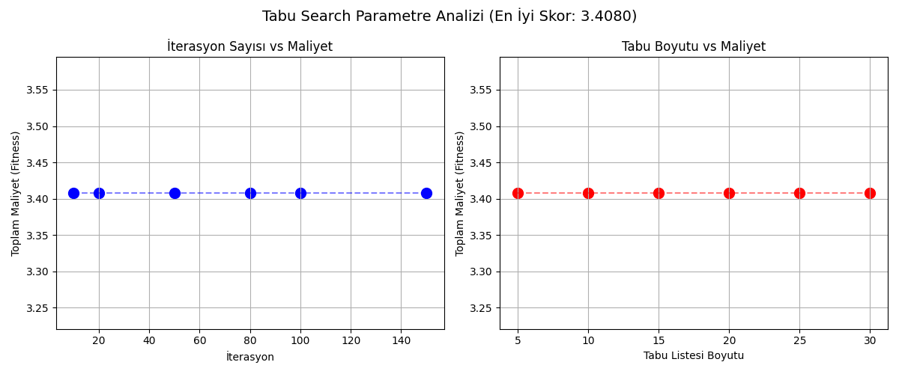

# Çok Amaçlı Ağ Optimizasyonu — Yönlendirme (Routing)

Bir ağ topolojisinde kaynak ve hedef düğüm arasındaki en uygun yolu, birbiriyle çelişen **üç amacı** birlikte gözeterek bulan yönlendirme projesi. Bilgisayar Ağları dersi (BSM307/317, Güz 2025) dönem projesi olarak ekip çalışmasıyla geliştirilmiştir.

## Problem

Bir yolun kalitesi tek bir ölçüyle belirlenmez. Bu projede her yol için üç maliyet hesaplanır:

| Amaç | Hesaplama |
|---|---|
| **Gecikme** | Bağlantı yayılım gecikmeleri + ara düğümlerin işlem süreleri |
| **Güvenilirlik** | Bağlantı ve düğüm güvenilirlikleri `-log(güvenilirlik)` ile toplanabilir maliyete çevrilir |
| **Kaynak maliyeti** | Her bağlantı için `1000 / kapasite` |

Üç maliyet, **ağırlıklı toplam (weighted sum)** yöntemiyle tek bir uygunluk değerine indirgenir (`w_gecikme`, `w_guvenilirlik`, `w_kaynak`). İstenen bant genişliğini karşılamayan bağlantılar sonsuz ceza alır.

## Kullanılan Algoritmalar

- **Dijkstra (NetworkX `shortest_path`)**: Karşılaştırma için temel yol
- **Genetik Algoritma**: Popülasyon tabanlı arama
- **Tabu Search**: Hafıza tabanlı yerel arama
- **Simulated Annealing**: Olasılıksal yerel arama
- **Q-Learning**: Pekiştirmeli öğrenme ile yol seçimi

## Dosya Yapısı

| Dosya | Açıklama |
|---|---|
| `network_model.py` | Ağ topolojisinin NetworkX ile kurulması ve yol maliyeti hesabı |
| `genetik_algoritma.py` | Genetik algoritma |
| `tabusearch.py` | Tabu Search |
| `simulated_annealing.py` | Simulated Annealing |
| `q_learning.py` | Q-Learning |
| `calistir.py` | Q-Learning, Genetik Algoritma ve Tabu Search'ü aynı kaynak–hedef çifti üzerinde çalıştırıp karşılaştırır |
| `*_NodeData.csv`, `*_EdgeData.csv`, `*_DemandData.csv` | Düğüm, bağlantı ve talep verileri |
| `tabu_parametre_test.png` | Tabu Search parametre denemelerinin sonucu |

## Çalıştırma

```bash
pip install networkx
python calistir.py
```

## Sonuçlar



## Teknolojiler

Python, NetworkX, Genetik Algoritma, Tabu Search, Simulated Annealing, Q-Learning
